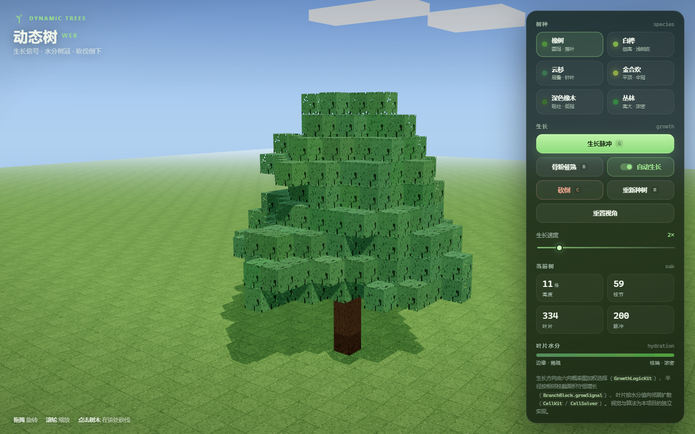

# Voxel Tree Lab



用浏览器复刻 **Dynamic Trees** 的核心生长逻辑：程序化生长、六向概率分枝、半径守恒、叶片水分扩散、点击砍伐与整树倒下。

渲染采用 **Minecraft 方块风格**：

- 树枝按 `radius` 缩放成方块柱，相邻方块之间自动补连接段；
- 树叶是整块 1×1 立方体，使用程序生成的 16×16 像素贴图；
- 树皮、年轮、草方块、根土、云、粒子和鼠标选框全部方块化。

所有树木逻辑、渲染组织、方块贴图和交互都在本仓库中实现。渲染底层使用 MIT 协议的 **Three.js 0.167.1**（已放在 `vendor/`，离线可用）。

## 运行

**推荐：双击 `start.bat`**

会自动启动本地服务器并打开浏览器；5173 被占用时会自动改用 5174、5175……出错时窗口会停住并显示原因。

也可以手动运行：

```bash
node serve.mjs
```

然后打开 <http://127.0.0.1:5173>。

> 浏览器不允许 `file://` 页面加载本地 ES Module，所以不要直接双击 `index.html`；请用 `start.bat` 或 `serve.mjs` 以 HTTP 方式访问。

需要支持 WebGL2 的现代浏览器（Chrome / Edge / Firefox / Safari）。

## 操作

| 操作 | 说明 |
|---|---|
| 拖拽 / 滚轮 | 旋转、缩放 |
| 悬停树体 | 显示 Minecraft 风格的方块黑框 |
| 点击树体 | 在该枝处砍伐，砍下的部分旋转倒下 |
| `G` / 生长脉冲 | 执行一次根土方块的生长脉冲 |
| `B` / 骨粉催熟 | 连续执行 14 次生长 |
| 自动生长 | 按“生长速度”滑杆持续生长 |
| `C` / 砍倒 | 从低处主干砍断整棵树 |
| `R` / 重新种树 | 重播当前树种 |
| 树种按钮 | 切换树种并重新种一棵 |

## 源码结构

```text
index.html          HTML / CSS / UI 外壳 + import map
src/
  app.js            应用状态、UI、输入、相机取景、主循环
  core.js           动态树逻辑（纯 JS，不依赖 Three.js）
  color.js          叶片水分值 → 实例颜色
  world.js          场景、相机、光照、像素贴图、地面、根土、云
  treeView.js       方块树枝/树叶实例化、悬停选框、砍口截面
  effects.js        方块粒子、砍倒动画
vendor/three/
  three.module.min.js
  addons/controls/OrbitControls.js
  LICENSE
serve.mjs           本地静态服务器（自动开浏览器、端口回退）
start.bat           Windows 启动脚本
```

### 模块职责

- **`core.js`**：完全不依赖渲染库，可以直接在 Node 中运行和测试。包含常量、六向概率图、`GrowSignal` 递归、半径回溯、叶片扩散、砍伐数据。
- **`world.js`**：只负责环境和资源：WebGL 渲染器、相机、OrbitControls、光照、天空、像素贴图工厂、草地、根土、方块云。
- **`treeView.js`**：把 `Tree` 的数据写进 `InstancedMesh`——每个枝节是一个按半径缩放的方块，边是连接方块；每个叶节点是一个完整方块。还负责物种贴图缓存、悬停黑框和砍口截面。
- **`effects.js`**：方块粒子、骨粉粒子、砍倒后的独立旋转组、落地扬尘与落叶；不关心 UI。
- **`app.js`**：把以上模块接起来，处理 UI 状态、键盘/鼠标、自动生长、相机自动取景和主循环。

## 动态树逻辑

### 1. 数据结构

整棵树由两个稀疏表组成：

```js
nodes:  Map<"x,y,z", { x, y, z, radius, parent, children }>
leaves: Map<"x,y,z", { x, y, z, hydro, owner }>
```

- `nodes` 中的每个格子是一段树枝，`radius` 为 1..8（17+ 用于粗树干）；
- `leaves` 中的每个格子是一片叶子，`hydro` 为 1..7，`owner` 指向最近的枝节；
- 根土方块在 `y=0`，树干从 `(0,1,0)` 开始。

### 2. 生长脉冲

```text
Tree.growPulse()
  └─ 按 growthRate 决定执行几次 sendSignal()
       └─ new GrowSignal(energy = signalEnergy)
            └─ Tree.growSignal(baseKey, signal)
```

一次信号是一条从根向外的递归路径：

1. `step()` 消耗 1 点能量，能量耗尽即停止；
2. 在当前位置用 **六向概率图** 选择下一方向；
3. 目标若是空气：粗枝放置新细枝和叶团，细枝只长单片叶；
4. 目标若是树叶：树叶转成一级细枝（`growIntoLeaf`）；
5. 目标若是已有树枝：递归进入该枝；
6. 回溯时按体积守恒更新半径：

```text
r = sqrt(Σ 相邻枝 r²) + tapering
```

7. 树干内允许长到 `maxRadius`，树干外最多 8；空间不足时 `choked`。

### 3. 六向概率图

```text
prob[UP]            = upProbability
prob[当前方向]      += 1
prob[邻居方向]      += 邻居是树枝 ? radius + 2 : 邻居是树叶 ? leafWeight : 0
```

低于 `lowestBranchHeight` 时强制向上；云杉（`conifer`）、金合欢（`acacia`）、丛林（`jungle`）有各自的概率修正。

### 4. 叶片水分

- 新叶从相邻树枝/树叶读取水分；
- 每个脉冲以一定概率向邻居扩散，水分 `hydro - 1`，最低为 1；
- 叶片颜色由 `hydro` 决定，边缘偏黄、稀疏，枝端更深更密；
- 叶团模板（`cluster`）决定不同树种的冠形。

### 5. 砍伐与倒下

`Tree.chopAt(key)` 收集该节点和全部后代，连同 `owner` 属于这些节点的叶子，生成独立数据；`effects.js` 用这些数据建立独立的 `InstancedMesh` 组，绕砍口旋转、碰撞落地、喷粒子，最后淡出。

## 树种参数

`src/core.js` 的 `SPECIES_LIST` 中每个树种可调：

```js
{
  tapering,      // 收细系数
  energy,        // 生长信号能量（决定单次信号能走多远）
  up,            // 向上概率
  lowest,        // 低于该步数时强制向上
  growthRate,    // 每个脉冲执行信号的期望次数
  maxRadius,     // 最大枝半径
  primary,       // 一级细枝半径
  secondary,     // 二级枝半径
  logic,         // 'default' | 'conifer' | 'acacia' | 'jungle'
  leafWeight,    // 树叶对方向概率的贡献
  leafSize,      // 树叶方块渲染尺寸
  cluster,       // 叶团椭球半径与形状
  bark, leaf     // 颜色
}
```

## 渲染细节

- **树枝**：方块核心尺寸为 `clamp(radius / 8, 0.125, 1.75)` 格；每个父/子节点之间画一个沿轴向的方块连接段，横截面取两端较小值。
- **树叶**：1×1×1 方块，实例颜色由水分决定，贴图为灰度像素图乘色；少量透明像素让枝条从叶隙露出。
- **贴图**：全部由 Canvas 2D 生成——树皮竖纹、白桦横斑、年轮、叶子、草方块、根土；使用 `NearestFilter`，没有使用 Minecraft 原版素材。
- **光照与阴影**：半球光 + 平行光 + PCFSoft 阴影。
- **悬停**：对实例网格做射线检测，把黑色线框放到对应方块格中心。
- **倒下**：被砍下的方块组使用独立的材质克隆，绕砍口旋转，落地后淡出并清理。

## 依赖与许可

- `vendor/three/`：Three.js 0.167.1 + OrbitControls，MIT License，许可证见 `vendor/three/LICENSE`。
- 其余代码、贴图、UI 均为本仓库实现。
- 动态树算法参考 Dynamic Trees 的设计思路，但没有复制其代码或美术资源。

## 已知简化

- 世界生成没有实现 Dynamic Trees 的 `JoCode` 预烘焙树形；本项目从一棵种子树实时生长。
- 叶片水分使用“叶团模板 + 邻接扩散”近似，而不是 mod 的 `CellSolver` 位运算。
- 倒下动画是定轴旋转，没有逐方块碰撞和实体伤害。
- 没有季节、病害、根系、果实、藤蔓、巨型树种等扩展系统。
- 每次重新种树外观都由 `Math.random` 决定。

## 可以继续扩展

1. 实现 JoCode 的编码/导出，把长好的树编码成方向串；
2. 用真正的 `CellSolver` 替换叶团扩散；
3. 按半径分档生成“核心 + 套管 + 年轮面”的方块模型；
4. 加入泊松圆盘森林、地形和存档导出。
